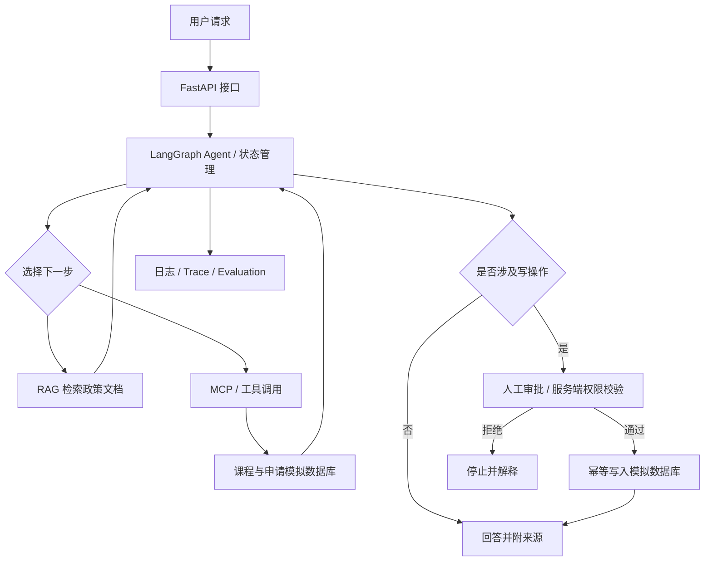

# AI Agent 校招 / 实习：12 周学习与求职行动计划（Codex 协作版）

> **适用对象**：计算机相关专业学生；具备独立编写基础项目的能力；目标为 AI Agent / LLM 应用开发相关**校招、实习**岗位。  
> **投入时间**：每周 10–15 小时，以下按 **12 小时/周** 规划。  
> **周期**：12 周；可以按实际进度延长，不必机械追赶。  
> **核心原则**：**原理 → 自己实现 → 框架实践 → 测试评估 → 工程交付 → 面试复盘**。  
> **主项目**：`CampusFlow`——校园知识库与事务办理 Agent。  
> **文档用途**：个人学习路线图、任务看板，以及交给 Codex 的长期项目上下文。  
> **版本**：v1.0（2026-10-09）

---

## 0. 如何使用这份文档

建议在新的 Git 仓库中保存为 `LEARNING_PLAN.md`，每周更新打卡项和复盘记录。将整个仓库交给 Codex 后，让它**先阅读本文件，再按当周目标协助你**。

**第一次与 Codex 对话，直接复制下面这段：**

```text
请先完整阅读仓库根目录的 LEARNING_PLAN.md。

我的背景：计算机相关专业学生，能独立写基础项目；
求职目标：AI Agent / LLM 应用开发校招或实习；
学习投入：每周 10–15 小时；
当前阶段：第 1 周（以后我会更新）。

请担任我的 Agent 工程导师与代码审查者，遵守这些规则：
1. 先指出本周学习目标、前置知识、任务拆分和验收标准。
2. 一次只推进一个最小可验证任务，不要一次生成整个项目。
3. 先让我自己尝试；默认先给思路、接口设计和提示，不直接贴完整答案。
4. 我请求实现代码时，才进行最小必要修改，并解释设计取舍。
5. 每完成一个任务，请告诉我如何运行、如何测试、有哪些边界场景。
6. 对代码问题请给出可复现的原因和验证办法，不编造测试结果。
7. 不接触真实账号凭据、私人数据或未经授权的学校系统。
8. 用中文交流；技术术语可同时标注英文。

现在先帮我制定 W1 的第一个 90 分钟学习任务，不要开始 W2 或后面的内容。
```

**建议协作方式**：你主导需求和设计，Codex 负责解释概念、检查实现、提供测试思路、审查代码和模拟面试。**不要让它自动写完 12 周项目**，否则项目会有，但你不一定能通过面试。

---

## 1. 个人定位与求职分析

### 1.1 当前画像

| 维度 | 当前情况 | 对学习策略的影响 |
| --- | --- | --- |
| 身份 | 计算机相关专业学生 | 需要兼顾校招算法与计算机基础 |
| 编程水平 | 能独立完成基础项目 | 可以直接开展 Python + LLM 实践，但保留基础查漏补缺 |
| 目标 | 校招 / 实习 | 看重可讲清的项目、代码能力、基本功和实习匹配度 |
| 时间 | 每周 10–15 小时 | 采用单一主项目，控制框架学习和技术栈复杂度 |
| 当前最大风险 | 学很多名词、项目不完整、不会解释实现 | 以可运行代码、测试、复盘、面试表达为验收结果 |

### 1.2 优先目标岗位

**推荐优先投递**：

1. **AI Agent 应用开发实习生 / 工程师**：LLM API、Function Calling、RAG、Agent 编排、工具与业务系统集成。
2. **LLM 应用研发实习生**：知识库、提示词、结构化输出、评测、服务端工程。
3. **AI 应用后端开发实习生**：Python、FastAPI、SQL、异步服务、Agent 集成。
4. **AI Coding / Agent 工程实习生**：如果目标 JD 明确偏代码智能体，则在后续加学代码分析、沙箱和自动化测试。

**现阶段不建议主攻**：

- Agent 算法研究：强化学习、模型训练、RL/GRPO、复杂推理研究等，通常需要更强算法研究基础。
- Agent Infra / Runtime 深水区：分布式调度、复杂沙箱、多租户隔离、Kubernetes 等，适合工程基础进阶后再选。

> 结论：先证明自己能够把**单 Agent 应用**从原型做成可测试、可恢复、可演示的系统，再决定是否转向算法或 Infra。

### 1.3 招聘方实际会考察什么

| 能力维度 | 需要拿出的证据 |
| --- | --- |
| 编程基础 | Python、数据结构、算法、SQL、HTTP、异常处理 |
| Agent 原理 | 能手写 Agent Loop；清楚 Tool Calling、ReAct、Workflow、MCP 区别 |
| RAG | 能构建检索流水线，解释 Chunk / Top-K / 召回 / 幻觉及优化过程 |
| 框架能力 | 能用 LangGraph 实现状态、路由、中断、恢复 |
| 工程质量 | 有日志、测试、错误处理、权限约束、部署说明 |
| 评测意识 | 提供测试集、指标定义、失败分析和真实优化结果 |
| 沟通表达 | 10 分钟讲清项目，能解释技术选择和失败案例 |

---

## 2. 技术优先级：现在必须掌握什么？

| 级别 | 技术与知识 | 要求 | 处理原则 |
| --- | --- | --- | --- |
| **P0 必须** | Python、Git、HTTP、JSON、SQL、异常处理 | 能独立编码并调试 | 有薄弱项立即补齐 |
| **P0 必须** | LLM API、Prompt、Structured Output、Function Calling | 能调用模型并验证结构化响应 | 第 1–2 周完成 |
| **P0 必须** | Agent Loop、ReAct、工具选择、循环终止 | 不依赖框架手写最小 Agent | 第 2 周完成 |
| **P0 必须** | RAG、Embedding、Chunking、检索和引用 | 搭建基础知识库并测评 | 第 3–4 周完成 |
| **P0 必须** | LangGraph、状态管理、基本测试 | 实现可执行状态图 | 第 5–6 周完成 |
| **P0 必须** | 算法、网络、数据库等校招基础 | 持续训练 | 12 周不断线 |
| **P1 重要** | MCP、状态持久化、Human-in-the-loop | 实现一个自定义工具服务和审批流 | 第 6–7 周完成 |
| **P1 重要** | FastAPI、SQLite、Docker、pytest | 提供服务接口、复现流程 | 第 8–11 周完成 |
| **P1 重要** | Evaluation、Tracing、安全、成本 | 有评测脚本与错误分析 | 第 9–10 周完成 |
| **P2 暂缓** | 多 Agent 复杂协作、AutoGen/CrewAI 全家桶 | 理解概念即可 | 不做主线 |
| **P2 暂缓** | LoRA / 大模型微调、RL、GRPO | 非算法岗不作为前 12 周重点 | 后续按 JD 补 |
| **P2 暂缓** | Kubernetes、分布式 Runtime、海量向量数据库 | 学习成本高、当前收益低 | 项目稳定后再学 |

**学习顺序不可倒置**：不要直接套多 Agent 框架而跳过 Agent Loop；不要先堆功能而不写测试；不要只靠提示词微调来代替检索评测。

---

## 3. 每周 12 小时时间预算

| 模块 | 时间 | 建议安排 |
| --- | ---: | --- |
| Agent 学习 + 主项目编码 | **7 小时** | 工作日 2×2 小时 + 周末 3 小时 |
| 算法 | **3 小时** | 每周 3–5 道，优先简单/中等题并复盘 |
| 计算机基础 | **1 小时** | 根据周主题补 HTTP、SQL、OS、Linux 等 |
| 学习复盘 + 求职 | **1 小时** | GitHub、周报、JD、面试题、简历更新 |
| **合计** | **12 小时** | 10 小时周削减扩展阅读，15 小时周增加测试/算法 |

**编码时间的建议占比**：学习原理约 20%，编码与调试约 60%，测试、总结和面试表达约 20%。

---

## 4. 主项目定义：CampusFlow

### 4.1 项目定位

**CampusFlow——校园知识库与事务办理 Agent**

用户示例请求：

> “我想申请一门跨专业课程，请帮我核对学校规定、查询课表；如果符合条件，就生成申请草稿，等我确认后再提交到模拟系统。”

### 4.2 最小可行功能（MVP）

1. **知识问答**：从允许使用的公开校规、课程规定、模拟制度资料中检索答案，并引用来源。
2. **工具使用**：查询课程信息、查询时间安排、生成申请草稿。
3. **任务执行**：识别用户意图，决定检索 / 查询 / 生成草稿等步骤。
4. **状态记忆**：保存会话、任务状态、草稿状态。
5. **人工审批**：涉及数据写入的操作在服务器侧必须检查审批结果，拒绝或超时不得执行。
6. **评测与日志**：保存测试样例、输出结果和关键调用记录。
7. **可运行服务**：提供 FastAPI 接口和本地 Docker 启动方案。

**数据约束**：使用公开且许可使用的材料和**模拟教务数据库**。不要抓取真实学生隐私信息，不调用未经授权的学校系统，不做真实选课或审批操作。

### 4.3 架构草图（目标状态，不要求 W1 一次完成）



### 4.4 技术栈建议（优先简单、可复现）

| 组件 | 第一版建议 | 暂时不做 |
| --- | --- | --- |
| Python | Python 3.11+；`venv` 或 `uv` 二选一 | 频繁更换环境工具 |
| 模型调用 | 一种支持 Tool Calling 的可访问模型 API | 同时集成多家模型 |
| Agent | 先纯 Python；第 5 周迁移 LangGraph | 框架全家桶 |
| RAG | Chroma 或 FAISS 二选一 | 分布式向量数据库 |
| API | FastAPI + Pydantic | 微服务拆分 |
| 业务数据库 | SQLite | 一开始就引入数据库集群 |
| MCP | 一个自写 Python MCP Server | 接十几个外部系统 |
| 评测 | pytest + JSON/JSONL 测试集 | 自建复杂评测平台 |
| 界面 | CLI → 简单 Web/Streamlit（可选） | 精致前端作为主目标 |
| 交付 | GitHub + Docker + README | Kubernetes |

### 4.5 建议的仓库结构（逐周增加，不需要提前建满）

```text
campusflow/
├── LEARNING_PLAN.md        # 本文档
├── README.md
├── pyproject.toml           # 或 requirements.txt；二选一
├── .env.example             # 只提供变量名和占位符
├── .gitignore
├── data/
│   ├── public_docs/        # 许可使用的公开文档或合成资料
│   ├── seed/               # 模拟课程与申请数据
│   └── eval/               # 固定评测集
├── src/campusflow/
│   ├── llm/                # 基础模型调用
│   ├── agent/              # 原生 Agent Loop，后迁移 LangGraph
│   ├── rag/                # 加载、切分、检索、引用
│   ├── tools/              # 本地工具 / MCP
│   ├── api/                # FastAPI
│   ├── storage/            # 数据与会话状态
│   └── eval/               # 评测入口和分析
├── tests/
├── docs/
│   ├── architecture.md
│   ├── evaluation.md
│   └── demo-script.md
└── Dockerfile
```

---

## 5. 12 周学习任务一览

| 周次 | 主题 | 必须产出 | 关键验收 |
| --- | --- | --- | --- |
| W1 | Python 工程、LLM API、结构化输出 | CLI 结构化输出助手 | JSON 符合 Schema，错误可处理 |
| W2 | Function Calling、ReAct、Agent Loop | 原生多工具 Agent | 会循环调用工具，有终止与限额 |
| W3 | RAG 基础 | 可引用来源的知识库 | 文档问答可运行，有无答案处理 |
| W4 | RAG 评测与优化 | 20–30 道检索问答基准 | 对比 Chunk / Top-K，记录结果 |
| W5 | LangGraph | 图编排版本 Agent | 条件路由和状态更新可验证 |
| W6 | Checkpoint、审批、恢复 | 可中断恢复的事务工作流 | 未审批不写入、恢复后能继续 |
| W7 | MCP | 自写 MCP Server + Agent 集成 | 工具可调用，失败能处理 |
| W8 | FastAPI、SQLite、pytest | `/chat` 等服务接口 | 端到端调用 + 基本自动测试 |
| W9 | Agent Eval、Tracing | 50 条固定测试集和实验报告 | 真实指标、失败分类、可复现 |
| W10 | 安全、超时、幂等与稳定性 | 安全加固 + 异常测试 | 越权写入被拦截，超时可处理 |
| W11 | Docker、文档、演示 | 可复现部署、README、3 分钟演示 | 新环境可按照说明启动 |
| W12 | 项目表达、简历、模拟面试 | 1 页简历、项目讲稿、面试复盘 | 10 分钟讲解项目并接受追问 |

---

## 6. 每周详细执行卡

> 使用方式：每周让 Codex 读取对应周任务，仅把当前周的 `[ ]` 勾选为 `[x]`。每完成一项保留相应代码、测试或文档证据。

### W1：Python 工程 + LLM API + Structured Output

**学习（建议 2 小时）**：虚拟环境、依赖管理、HTTP/JSON、Pydantic 校验、模型 API 的请求/响应、Token 基本概念、异常和超时。

**实践（建议 5 小时）**：做一个 CLI 助手，把“帮我查周三下午的选修课”等自然语言输入解析为结构化意图对象：`intent`、`course`、`time_range`、`requires_approval` 等。

**本周清单**：

- [x] 初始化仓库、虚拟环境、`.gitignore` 和 `.env.example`。
- [x] 完成一个最小模型 API 请求（**API Key 只读取环境变量**）。
- [x] 用 Pydantic 定义结构化输出 Schema，并校验模型响应。
- [x] 处理网络失败、超时、无效 JSON、缺失字段等异常。
- [x] 添加至少 5 条自动测试（可 Mock 模型响应，避免测试消耗 Token）。
- [x] 写出第一篇学习笔记：Prompt、Schema 和普通自由文本输出的区别。

**验收**：命令行输入请求，输出合法 JSON；非法响应能稳定报错或重试，不会直接崩溃。

**面试准备**：Structured Output 与仅在 Prompt 中要求返回 JSON 有何区别？Python `async` 与同步调用有什么区别？

**算法 / 基础**：数组、哈希表；HTTP 请求与响应。

### W2：自己实现 Function Calling 和 Agent Loop

**学习**：Tool Schema、工具参数校验、ReAct、Observation、Agent Loop、最大迭代次数、工具权限。

**实践**：不使用 Agent 框架，只用普通 Python 实现多轮循环，并配置 3 个确定性本地工具，例如：`get_course_info`、`get_course_schedule`、`calculate_credit_total`。

**本周清单**：

- [x] 定义 3 个工具及对应参数 Schema。
- [x] 实现模型选择工具 → 参数校验 → 执行 → 将结果回传模型的循环。
- [x] 加入 `max_steps` 和工具白名单，阻止无限循环或任意函数执行。
- [x] 工具不存在或参数非法时返回明确错误，不使循环失控。
- [x] 加入可读日志，记录所选工具、耗时和成功/失败状态。
- [x] 用自己的语言画出 Agent Loop，并解释 ReAct 与普通函数调用的关系。

**验收**：至少 3 类测试任务能触发不同工具；终止逻辑、错误分支有测试。

**面试准备**：Function Calling 与 Agent 有何关系？为什么不能让模型直接执行任意代码？

**算法 / 基础**：双指针、滑动窗口；JSON 与接口设计。

### W3：RAG 基础

**学习**：Document Loader、Chunking、Embedding、向量相似度、Top-K、上下文引用、无答案场景。

**实践**：导入一批许可使用的校园规章/培养方案文档；把来源、文件名、页码或章节号保留为 Metadata；完成 `ingest → retrieve → answer`。

**本周清单**：

- [ ] 准备公开且许可使用的文档或自行编写的合成校规。
- [ ] 实现文档加载、切块、索引构建。
- [ ] 实现根据用户问题检索相关 Chunk。
- [ ] 在回答中附来源标识；没有依据时说明无法确认。
- [ ] 手工验证 10 条问题，包括有答案和无答案情况。
- [ ] 记录语料规模、切块规则、模型/向量化方案。

**验收**：回答能引用具体来源；不凭空编造校规。

**面试准备**：Embedding 是什么？为什么需要 Chunking？RAG 与直接把全文塞进 Prompt 有何区别？

**算法 / 基础**：链表；SQL 查询、主键和索引。

### W4：RAG 进阶评测

**学习**：Chunk Size、Overlap、Top-K、关键词与向量检索、检索召回、重排概念、回答真实性。

**实践**：准备 20–30 条标注了参考答案或参考文档的固定问答测试；至少对比两组参数。

**本周清单**：

- [ ] 设计 20–30 条测试，包括易混淆问题、无答案问题。
- [ ] 比较至少两组 Chunk Size / Top-K 配置。
- [ ] 计算可解释的检索命中指标，例如 Recall@K（需有相关文档标注）。
- [ ] 手工检查回答正确性和引用准确性。
- [ ] 将失败案例分为“检索不到、检索到但生成错误、资料不足”等类别。
- [ ] 记录对比结果，不预设“提升了 XX%”。

**验收**：提交 `docs/rag-experiments.md`，写明数据、参数、方法、结果和局限。

**面试准备**：召回与精度如何权衡？为什么检索正确不等于最终答案正确？

**算法 / 基础**：栈与队列；数据库事务。

### W5：LangGraph 入门与工作流编排

**学习**：`StateGraph`、Node、Edge、Conditional Edge、State 更新、Workflow 与 Agent 的边界。

**实践**：将 W2 的工具循环和 W3 的检索能力组合成有状态工作流，实现“意图识别 → 路由 → 检索/工具 → 汇总”。

**本周清单**：

- [ ] 实现至少 4 个职责明确的节点。
- [ ] 至少包含一个条件分支。
- [ ] 测试不同输入是否进入预期节点。
- [ ] 使用结构化 State 保存必要字段，不无限堆积上下文。
- [ ] 记录为什么选择 LangGraph、哪些逻辑保留为普通函数。

**验收**：每条典型任务可清楚追踪经过了哪些节点和为什么。

**面试准备**：Workflow、ReAct Agent、Multi-Agent 的区别？LangGraph 的 State 是什么？

**算法 / 基础**：二分查找；进程与线程。

### W6：Checkpoint、Memory 与人工审批

**学习**：会话状态、Checkpoint、持久化、Interrupt/Resume、Human-in-the-loop、工具副作用。

**实践**：用户提出选课申请 → Agent 生成草稿 → 中断等待确认 → **服务端校验审批状态** → 写入模拟数据库。

**本周清单**：

- [ ] 持久化会话和申请草稿状态。
- [ ] 实现人工审批中断以及恢复流程。
- [ ] 明确区分“生成草稿”和“实际提交”。
- [ ] 测试未审批、拒绝审批、恢复执行三种情况。
- [ ] 为写操作设计申请 ID / 幂等标识，避免重复提交。

**验收**：中断后可恢复；任何模型输出都不能绕过服务器端审批校验。

**面试准备**：短期上下文与持久 Memory 的区别？为何审批不能只写在 Prompt 中？

**算法 / 基础**：二叉树遍历；TCP / HTTP。

### W7：MCP 工具服务

**学习**：MCP Client / Server、Tools、Resources、工具协议、权限边界、MCP 与 Function Calling 关系。

**实践**：把至少一个本地工具封装为 Python MCP Server，由 Agent 通过 MCP Client 调用；另一个工具保留为本地函数，做设计比较。

**本周清单**：

- [ ] 创建一个本地 MCP Server。
- [ ] 提供课程信息查询或申请草稿查询工具。
- [ ] 编写 MCP 工具调用的最小集成测试。
- [ ] 处理连接失败、超时、工具参数非法。
- [ ] 记录“何时使用本地工具，何时使用 MCP”的判断标准。

**验收**：Agent 能真实调用自己开发的 MCP 服务，并能处理异常返回。

**面试准备**：MCP 与 REST API、Function Calling 分别处于什么层次？

**算法 / 基础**：DFS / BFS；Linux 基本命令。

### W8：FastAPI + SQLite + pytest

**学习**：REST API、HTTP 状态码、请求体校验、数据库持久化、pytest、接口测试、基本权限概念。

**实践**：将项目从 CLI 升级为服务端应用，建议最少实现：

- `POST /chat`：提交用户任务；
- `GET /sessions/{session_id}`：查看状态；
- `POST /applications/{application_id}/approve`：模拟人工审批（服务器端验证）。

**本周清单**：

- [ ] 定义接口请求/响应 Schema 和状态码。
- [ ] 将草稿、任务与审批状态持久化到 SQLite。
- [ ] 为主要 API 添加成功与失败路径的 pytest 测试。
- [ ] 将模型调用与核心业务逻辑隔离，支持 Mock 测试。
- [ ] 如无真实用户认证，明确标注该系统是**单用户本地演示**，不可暴露为生产审批服务。

**验收**：通过 API 可以完成一条端到端任务，关键接口测试能重复运行。

**面试准备**：为什么选 FastAPI？怎样确保工具调用和数据库写入保持一致性？

**算法 / 基础**：回溯；异步编程与数据库设计。

### W9：Agent Evaluation 与 Tracing

**学习**：指标设计、离线评测、固定样本集、模型随机性、Trace、成本与延迟。

**实践**：建立 **50 条固定测试样例**：

| 测试类别 | 数量 | 检查点 |
| --- | ---: | --- |
| 知识库问答 | 20 | 答案是否有依据、引用是否正确 |
| 工具调用 | 10 | 工具选择与参数是否正确 |
| 多步骤任务 | 10 | 整体任务是否完成、状态是否一致 |
| 异常和安全 | 10 | 拒答、权限拦截、失败恢复 |

**本周清单**：

- [ ] 用 JSON/JSONL 维护测试集、输入、预期结果与样本 ID。
- [ ] 定义任务成功率、工具选择正确率、端到端延迟、成本等指标。
- [ ] 建立自动评测入口，至少跑一次基线实验。
- [ ] 在相同测试条件下尝试一次针对性优化与复测。
- [ ] 保存失败案例和原始结果，不只截图展示“成功样例”。

**验收**：`docs/evaluation.md` 可复现评测方法；报告中**只展示实际测得的数字**。

**面试准备**：Agent 成功率如何定义？LLM 输出有随机性时如何做公平比较？

**算法 / 基础**：动态规划入门；Redis 基本概念。

### W10：可靠性与 Agent 安全

**学习**：Prompt Injection、工具越权、最小权限、超时、重试、幂等、对外部文档不可信的处理原则。

**实践**：设计针对知识库文本、用户指令和工具返回值的对抗性/异常测试，验证不可信文本不能获得更高权限。

**本周清单**：

- [ ] 对所有工具参数进行严格校验。
- [ ] 实现外部调用超时和受控重试策略。
- [ ] 为关键写操作增加幂等与服务端权限检查。
- [ ] 准备至少 5 条 Prompt Injection / 越权场景测试。
- [ ] 记录哪些防护是代码层面的，哪些仅是提示词约束。
- [ ] 检查日志、仓库和演示中是否泄露密钥或敏感数据。

**验收**：恶意文档内容无法绕过审批；模拟工具故障不会触发重复写入。

**面试准备**：如何限制 Agent 权限？工具调用失败时怎样避免业务事故？

**算法 / 基础**：高频题复盘；并发与锁的基础。

### W11：部署与作品集

**学习**：Dockerfile、环境变量、依赖锁定、README、演示脚本。

**实践**：用 Docker 复现本地服务；整理项目文档，录制约 3 分钟的视频演示（可用合成数据）。

**本周清单**：

- [ ] 能依据 README 从干净环境安装并启动项目。
- [ ] 给出 `.env.example`，确保真实密钥不会进入 Git 历史。
- [ ] 提供系统架构图和主要技术决策。
- [ ] 提供测试命令、评测数据说明和真实结果。
- [ ] 准备演示流程：普通问题 → 多步骤任务 → 审批 → 异常处理。
- [ ] 有条件时部署可访问 Demo；不具备认证和权限控制时仅提供本地演示。

**验收**：另一个开发者可以只看 README 完成启动；演示视频覆盖核心功能。

**面试准备**：项目最大技术难点是什么？有没有做过错误取舍，后来如何修正？

**算法 / 基础**：限时模拟题；Linux/Docker 基础。

### W12：简历与面试冲刺

**学习**：技术面试故事线、工程权衡、行为面试、项目表达。

**实践**：完成一页简历，针对 3 个不同岗位 JD 做匹配分析，与 Codex 至少开展 2 次模拟面试。

**本周清单**：

- [ ] 准备项目 30 秒、2 分钟、10 分钟三个版本的介绍。
- [ ] 简历中使用**真实测量**的结果描述优化效果（没有数据就不编数字）。
- [ ] 能手绘/讲解项目数据流、Agent Loop、RAG、状态管理和审批逻辑。
- [ ] 完成 2 次技术模拟面试；保留追问、薄弱知识点、改进记录。
- [ ] 检查算法高频题和计算机基础的遗漏主题。
- [ ] 根据真实 JD 调整投递关键词和项目表述。

**验收**：能从需求、设计、实现、异常、评测到部署完整介绍项目，并回答面试追问。

**算法 / 基础**：算法综合复盘；数据库/网络/操作系统综合问答。

---

## 7. 学习阶段里程碑（Gate）

每过一个里程碑，先验收再进入下一阶段，避免堆功能但缺乏理解。

### M1｜W2 结束：原生 Agent

- [ ] 不依赖 LangGraph 等框架手写 Agent Loop。
- [ ] 有 3 个工具、参数校验、错误处理、最大执行次数。
- [ ] 能口述一个任务从输入到最终答案的全过程。

### M2｜W4 结束：有证据的 RAG

- [ ] 支持文档来源引用和无答案处理。
- [ ] 有 20–30 个标注问题及至少一次参数对比。
- [ ] 能区分检索失败与生成失败。

### M3｜W8 结束：工程化 Agent

- [ ] 工作流支持状态、恢复、审批。
- [ ] 至少一个 MCP Server 已集成。
- [ ] FastAPI、数据库和自动测试连通。

### M4｜W12 结束：可投递作品

- [ ] 有 50 条评测样例及真实结果。
- [ ] 支持至少一种异常恢复与权限防护。
- [ ] README、Docker、项目演示、技术设计文档齐备。
- [ ] 已完成简历和模拟面试复盘。

---

## 8. 校招专项：算法和计算机基础

保持每周 **3 小时 / 3–5 题** 的连续训练。先保证理解和复盘，再追求题量；不建议只追刷题数量。

| 周次 | 算法主题 | 计算机基础 |
| --- | --- | --- |
| W1–W2 | 数组、哈希、双指针、滑动窗口 | Python、HTTP、JSON |
| W3–W4 | 链表、栈、队列 | SQL、索引、事务 |
| W5–W6 | 二分、二叉树 | 进程/线程、TCP/HTTP |
| W7–W8 | DFS、BFS、回溯 | Linux、异步编程、数据库设计 |
| W9–W10 | 动态规划基础、综合题 | Redis、锁、异常与幂等 |
| W11–W12 | 高频错题与限时模拟 | 网络、数据库、OS 综合复盘 |

每题保留：`题目链接 / 思路 / 时间复杂度 / 空间复杂度 / 错误原因 / 二刷结果`。可让 Codex 提供提示、设计反例、检查复杂度；**不要一开始就直接索要标准解法**。

---

## 9. Agent 面试核心问题库

每题需要做到：**不看资料讲清原理 + 画流程 + 结合项目举例**。

- [ ] Function Calling 与 MCP 分别解决什么问题？
- [ ] ReAct 的核心循环是什么？如何防止无限循环？
- [ ] Workflow、单 Agent、多 Agent 的区别是什么？
- [ ] Embedding 和向量检索是什么？
- [ ] Chunk Size、Overlap、Top-K 如何影响召回和成本？
- [ ] 为什么 RAG 检索到正确文档仍可能回答错误？
- [ ] LangGraph 的 State、Checkpoint、Interrupt 是什么？
- [ ] Agent 中断后如何恢复？恢复时如何避免重复提交？
- [ ] 如何让模型工具调用受到最小权限约束？
- [ ] 为什么审批逻辑不能只写在 System Prompt 中？
- [ ] 如何定义并衡量 Agent 任务成功率？
- [ ] 如何比较两版 Agent 的效果，避免只凭主观 Demo？
- [ ] Prompt Injection 从外部文档进入时应该怎么防守？
- [ ] 如何降低推理延迟与 Token 成本？
- [ ] 你项目里最难复现的 Bug 是什么？如何定位？

**推荐面试叙述方式**：问题背景 → 方案选型 → 关键实现 → 失败案例 → 评测证据 → 权衡与改进。

---

## 10. 求职时间线与简历策略

| 阶段 | 求职任务 |
| --- | --- |
| W1–W3 | 搜集约 15–20 条目标 JD，提取重复出现的技术要求与学历/到岗条件 |
| W4–W6 | GitHub 发布初版项目，制作一页简历，开始少量试投并记录反馈 |
| W7–W10 | 结合 JD 集中投递；技术面试后当周补短板 |
| W11–W12 | 完善 README、真实评测和演示；开展针对性模拟面试 |

**岗位关键词**：`AI Agent 实习`、`LLM 应用研发`、`智能体研发`、`AI 应用后端`、`AI Coding 工程`。

**筛选条件**：关注毕业时间、每周到岗天数、实习最短时长、城市与技术栈。先匹配条件，再投递。

**可用于简历的描述骨架（填真实结果，不要直接照抄数字）**：

> 设计并实现 CampusFlow 校园事务智能体，基于 Python、LangGraph、RAG 与 MCP 构建多步骤任务工作流，支持文档引用、工具调用、会话状态持久化与人工审批；使用固定测试集对检索及端到端任务进行评测，并针对实际失败案例优化系统可靠性与延迟。

如果有真实数据，可补充：`共 N 条测试样例；端到端成功率由 A 提升至 B；P95 延迟由 C 降至 D`。**未经测量，不填写指标。**

---

## 11. Codex 协作规范（建议长期沿用）

### 11.1 学习时的职责分工

| 任务 | 你来做 | Codex 来协助 |
| --- | --- | --- |
| 知识学习 | 先尝试理解并复述 | 讲概念、举例、做小测 |
| 需求拆解 | 定义目标与验收 | 检查任务是否合理、拆子任务 |
| 核心实现 | 先写初版 | Review、提示、补测试、辅助 Debug |
| 工程配置 | 明确环境和约束 | 给出可重复执行的步骤与说明 |
| 评测 | 决定指标并分析失败 | 生成样例草稿、编写评测脚本、检查统计口径 |
| 面试 | 独立回答 | 连续追问、指出表达空洞处 |

### 11.2 每次任务的固定循环

1. **任务开始**：明确当前 W 编号、任务 ID、目标、输入和验收标准。
2. **自己设计**：先写伪代码或接口定义，让 Codex 审查。
3. **小步实现**：一次推进一个独立功能；所有修改都能解释。
4. **测试验证**：运行单元测试和边界测试；不能运行时明确说明未验证。
5. **提交 Git**：按功能提交，提交信息可用 `feat: ...`、`test: ...`、`docs: ...`。
6. **当天复盘**：记录 3 个学到的点、1 个 Bug、1 个遗留问题。

### 11.3 Codex 常用提示词

**A. 讲解概念但先不写代码**

```text
我正在学习 W{周次} 的「{主题}」。请先用面向校招生的方式解释：
1. 它解决什么问题；2. 核心机制；3. 一个贴近 CampusFlow 的例子；
4. 最容易出现的两个误区；5. 给我 3 道检查理解的问题。
先不要为我编写完整项目代码。
```

**B. 给出任务拆分**

```text
请阅读 LEARNING_PLAN.md 的 W{周次}，将「{任务}」拆成 3–5 个
可独立验证的小步骤。每一步给出：要修改的文件、接口约定、
最低测试要求、完成定义。先只执行第 1 步。
```

**C. 代码审查（不要替我重写）**

```text
请 Review 当前分支与主分支的代码差异，优先检查：
正确性、边界条件、异常处理、状态一致性、权限、可测试性。
按严重程度排序问题，指出文件与位置。默认只给修改建议，
不要直接重构整个模块。请给我一个最先要解决的问题。
```

**D. 调试引导**

```text
我遇到以下错误：{错误日志}。
请不要直接猜原因或大面积修改代码。先给出最可能的
2–3 个根因，以及每个根因对应的最小验证步骤。
需要补充日志或复现脚本时先说明目的。
```

**E. 测试与评测**

```text
根据 LEARNING_PLAN.md 中 W{周次} 的验收标准，
帮我设计覆盖正常、边界、异常和安全路径的测试清单。
区分 Mock 单测、集成测试和真实模型评测。
不要伪造运行结果；每个指标写清计算口径。
```

**F. 模拟面试**

```text
请作为 Agent 应用研发实习岗位的技术面试官，
围绕我的 CampusFlow 项目连续提问 20 分钟。
每次只问一个问题，等待我回答后追问，
重点关注 Agent Loop、RAG、LangGraph、MCP、
状态恢复、异常处理、评测、安全和工程取舍。
最后按技术准确性、深度、表达清晰度打分并给出改进建议。
```

### 11.4 安全与质量约束

- **密钥与配置**：API Key 不写入代码、日志或 Markdown；用 `.env`，仓库仅提交 `.env.example`。
- **费用**：为模型调用配置超时、最大步骤数、预算/次数上限；测试优先 Mock，真实模型评测分批进行。
- **来源可信度**：检索到的文档与工具输出属于外部数据，不应成为更高优先级指令。
- **权限**：凡涉及写入、删除、提交、对外发送等操作，授权必须由可信业务代码检查。
- **可复现性**：关键行为配测试，实验记录模型、提示词版本、数据集、配置和运行日期。
- **独立掌握**：凡是 Codex 生成的关键代码，你必须能够解释每个模块为什么存在。

---

## 12. 每周进度记录模板

每周复制以下模板到 `notes/week-XX.md`（不一定需要一开始建文件）：

```markdown
# Week XX 学习周报

## 本周目标
- [ ] 目标 1
- [ ] 目标 2
- [ ] 目标 3

## 实际投入
- Agent 学习与项目：__ 小时
- 算法：__ 小时，__ 道
- 计算机基础：__ 小时
- 复盘/求职：__ 小时

## 本周交付
- 代码提交：
- 测试结果：
- 文档或评测报告：
- 演示链接/截图：

## 我真正掌握的 3 件事
1.
2.
3.

## 遇到的 Bug 与定位过程
- 现象：
- 根因：
- 验证方法：
- 解决方式：

## 面试题自测
- 能独立解释的问题：
- 需要继续补的知识：

## 下周优先级
1.
2.
3.
```

**任务级 Done 定义**：代码运行通过 + 测试覆盖关键边界 + 你能解释实现 + 文档有使用方式。缺其中任意一项，就不算真正完成。

---

## 13. 第 1 周立即执行任务（可直接发给 Codex）

**任务 ID：W1-T1｜初始化 Python 项目并定义结构化输出**

**目标**：完成 CampusFlow 的第一块独立能力：从自然语言提取任务意图并输出通过 Pydantic 校验的 JSON。

**输入示例**：

```text
下周三下午我想上一门 2 学分的通识课，帮我看看有哪些选择。
```

**输出示例（示意，不是实际 API 返回）**：

```json
{
  "intent": "search_courses",
  "time_range": "下周三下午",
  "credits": 2,
  "course_category": "通识课",
  "requires_approval": false
}
```

**建议实现顺序**：

1. 初始化仓库、虚拟环境、依赖管理与 `.gitignore`。
2. 定义 `UserIntent` 的 Pydantic Schema。
3. 先用一段**假的模型响应**完成解析与校验。
4. 接入真实 LLM API（从环境变量读取密钥）。
5. 编写至少 5 个测试场景：正常、字段缺失、非法类型、无效 JSON、接口超时。
6. 完成 `README.md` 中的最小运行命令。

**验收标准**：

- [ ] 本地能运行 `python -m ...`（具体入口由实际实现决定）。
- [ ] 输出符合 Pydantic Schema。
- [ ] 能明确报告无效输入与 API 异常。
- [ ] 不在 Git 中提交 API Key。
- [ ] 你能解释 Pydantic 校验与仅靠 Prompt 要求 JSON 的区别。

**专用 Codex 提示词**：

```text
请阅读 LEARNING_PLAN.md 的「W1」和「第 1 周立即执行任务」。
我准备完成 W1-T1，请先帮我确定目录结构、Pydantic 的 UserIntent
数据模型字段和 5 条测试用例。
不要直接生成完整项目。先让我自己实现第 1 步，
然后根据我的代码进行 Review。
```

---

## 14. 参考资料（优先官方文档与开源项目）

> 框架 API 会更新；遇到教程示例不一致时，以对应版本的官方文档为准。以下链接用于学习方向参考，不代表必须全部看完。

### Agent 与 LLM

- [Anthropic：Building Effective Agents](https://www.anthropic.com/research/building-effective-agents)：理解 Agent/Workflow 的架构取舍。
- [OpenAI 开发文档](https://platform.openai.com/docs)：模型调用、结构化输出、工具调用。
- [OpenAI Agents SDK（Python）](https://openai.github.io/openai-agents-python/)：后期对比工具、Handoffs 与 Tracing 的思路。
- [Datawhale Hello-Agents](https://github.com/datawhalechina/hello-agents)：中文 Agent 学习材料。

### RAG、LangGraph 与 MCP

- [LangGraph 官方文档](https://docs.langchain.com/oss/python/langgraph/overview)：StateGraph、Persistence、Interrupt。
- [MCP 官方站点](https://modelcontextprotocol.io/)：协议、Client/Server、Python SDK 与安全说明。
- [Datawhale 组织](https://github.com/datawhalechina)：查找相关 RAG 开源教程；具体仓库和代码版本使用前确认。

### 工程、测试与安全

- [FastAPI 官方教程](https://fastapi.tiangolo.com/zh/tutorial/)：HTTP API 与请求校验。
- [pytest 官方文档](https://docs.pytest.org/)：测试组织与 Fixture。
- [LangSmith 官方文档](https://docs.langchain.com/langsmith/home)：Agent 评测与 Tracing（不必一开始接入）。
- [OWASP LLM Top 10](https://owasp.org/www-project-top-10-for-large-language-model-applications/)：LLM 应用常见安全风险。
- [LeetCode 热题 100](https://leetcode.cn/studyplan/top-100-liked/)：算法训练入口。

---

## 15. 最终核对清单

### 能力
- [ ] 独立实现 Agent Loop，不依赖框架也能解释原理。
- [ ] 会处理工具参数校验、失败和终止条件。
- [ ] 搭建有来源引用的 RAG，理解检索质量与生成质量。
- [ ] LangGraph 工作流具备路由、持久化和人工审批。
- [ ] 掌握至少一个自定义 MCP Server。
- [ ] 能用真实评测数据说明项目优缺点。

### 作品集
- [ ] 代码仓库清晰、敏感信息安全。
- [ ] 一条完整任务可运行；异常场景可复现。
- [ ] 至少 50 条评测样例及报告。
- [ ] README、架构图、测试、Docker、演示素材齐全。

### 求职
- [ ] 每周持续练算法与计算机基础。
- [ ] 看过 15–20 份目标 JD，并归纳高频要求。
- [ ] 完成项目介绍的 30 秒 / 2 分钟 / 10 分钟版本。
- [ ] 做过至少 2 次模拟面试。
- [ ] 简历仅使用真实可验证的结果，不虚构性能数字。

---

**总原则**：对校招候选人，最有竞争力的组合是**扎实的基础 + 一个做深做透的 Agent 项目 + 可复现的工程与评测证据**。把 Codex 当成导师、代码审查者和面试官，而不是自动代写整套项目的工具。
